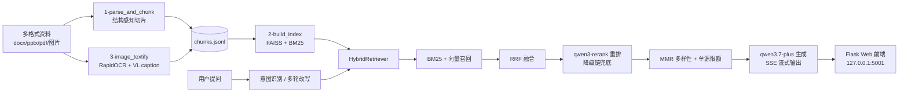

# Multimodal-RAG · 迪士尼智能客服问答助手

一个面向「迪士尼乐园智能客服」场景的多模态检索增强生成（RAG）系统：将 Word / PPT / PDF / 图片等多格式运营资料构建为知识库，支持图文混合检索与大模型流式问答，覆盖门票规则、酒店会员制度、游玩攻略、应急处理等常见客诉问题。

> 本仓库仅包含**实际工作代码与测试评估代码**；原始知识库资料、构建产物（索引/缓存/评估结果）与密钥均不入库。

## 一、实现背景

传统客服 FAQ 机器人难以应对两类问题：

1. **知识散落在多格式文档里**——门票规则是 Word、培训课件是 PPT、制度手册含大量表格与扫描页，关键词搜索无法理解语义；
2. **用户问题口语化且多轮**——"小孩多大不要票""天生一对是哪一年"这类提问需要意图识别、多轮澄清与改写，而非简单关键词匹配。

本项目用 RAG 方案解决：文档切片入库 → 混合检索召回 → 重排精筛 → 大模型生成带引用的回答，并配套完整的**评估 / 诊断 / 烟测**工具链，让每次调参都有量化依据。

## 二、技术架构



| 层 | 关键设计 |
|---|---|
| **数据层** | 目标 800 字/重叠 120 字结构感知切片：表格整块保留 Markdown、PPT 每页独立 chunk、短块合并、PDF 扫描页自动 RapidOCR；正文 hash 去重，chunk 携带 `文档标题>章节` 路径 |
| **索引层** | `tongyi-embedding-vision-plus`（1152 维）+ FAISS `IndexFlatIP`；BM25 为字符二元组纯 Python 实现（无 jieba 依赖）；图片经 OCR + VL 模型转文本后一同入库 |
| **检索层** | BM25 + 向量双路召回 → RRF 融合 → `qwen3-rerank` 重排（**降级链**：AGICTO 首选 → 百炼兜底）→ MMR 多样性 + 单文件结果上限 |
| **生成层** | `qwen3.7-plus`，SSE 流式输出，回答带 `[n]` 编号引用；意图识别支持澄清反问、多意图拆分、指代消解改写 |
| **应用层** | Flask：多轮会话（TTL/上限）、接口限流、embedding LRU 缓存、`/api/health` 全链路体检 |
| **评估层** | 检索 2×2 网格 + 答案侧网格 + 意图金标集 + rerank 核验；QA 集按 `chunk_hash` 与索引解耦，重建索引评估不归零 |

全部模型走 **AGICTO 平台**（OpenAI 兼容接口，每模型独立 Key），百炼（DashScope）Key 仅作 rerank 降级兜底，可经 `.env` 切换生成平台。

## 三、环境要求

| 项 | 要求 |
|---|---|
| 操作系统 | Windows 10/11（`0-转换旧格式.ps1` 依赖 Office COM；FAISS 中文路径已做 ASCII 中转处理） |
| Python | 3.11 / 3.12（建议 3.11） |
| 密钥 | AGICTO 平台 Key（embedding / 生成 / 改写 / VL / rerank 各一枚）；DashScope Key 可选（rerank 兜底） |
| 本地模型 | 仅 RapidOCR（onnxruntime），无需 GPU |
| 可选 | Microsoft Office + PowerShell 7（仅当资料含 `.doc/.ppt` 旧格式时用于转换） |

## 四、快速开始

```powershell
# 1) 虚拟环境 + 依赖
python -m venv .venv
.venv\Scripts\pip install -r requirements.txt

# 2) 配置密钥（必须）
copy .env.example .env
# 编辑 .env 填入 AGICTO 各模型 Key；DASHSCOPE_API_KEY 可选（rerank 降级兜底）

# 3) 准备知识库资料（本仓库不附带原始资料）
#    在仓库同级目录创建 迪士尼RAG知识库（完整）/ 文件夹放入你的 docx/pptx/pdf/图片，
#    或修改各脚本顶部的 KB_ROOT 指向你的资料目录。
#    含 .doc/.ppt 旧格式时先转换（需 Windows + Office + PowerShell 7）：
pwsh -Command "& '.\0-转换旧格式.ps1'"

# 4) 构建知识库：切片 → 图片文本化 → 入库
.venv\Scripts\python 1-parse_and_chunk.py
.venv\Scripts\python 3-image_textify.py
.venv\Scripts\python 2-build_index.py

# 5) 启动服务，浏览器访问 http://127.0.0.1:5001
.venv\Scripts\python frontend\app.py
```

## 五、目录结构

```
Multimodal-RAG/
├── .env.example          # 密钥模板（复制为 .env 后填入，.env 不入库）
├── requirements.txt
├── 0-转换旧格式.ps1       # Word/PowerPoint COM：.doc/.ppt → .docx/.pptx（可选）
├── 1-parse_and_chunk.py  # 解析 + 结构感知切片（表格整块、短块合并、OCR 扫描页）
├── 2-build_index.py      # embedding 入库（FAISS IndexFlatIP + BM25），断点续传
├── 3-image_textify.py    # 图片 OCR(RapidOCR 本地) + qwen3.5-omni-flash caption
├── 4-evaluate.py         # 主评估：检索网格 + 答案侧 + 改写/意图口径 + 意图金标 + rerank 核验
├── 5-diagnose.py         # 体检/同源校验（all）+ 阈值标定（calib）
├── smoke_test.py         # 线上链路烟测（检索/降级/SSE）
├── eval_intent_gold.json # 意图专用人工金标集
├── query_intent_prompts.md # 意图识别 Prompt 设计文档
├── lib/
│   ├── settings.py       # 集中配置（密钥/超参全部来自环境变量/.env）
│   └── retriever.py      # BM25 / RRF / rerank 降级链 / HybridRetriever / MMR / 意图规则门
├── frontend/
│   ├── app.py            # Flask 服务（SSE 流式、会话、限流、/api/health）
│   ├── templates/index.html
│   └── static/marked.min.js
└── output/               # 构建产物（运行时生成，gitignore）：索引、metadata、BM25、评估结果
```

## 六、评估与测试

```powershell
# 主评估（检索 + 答案 + 意图），结果写入 output/eval_results.json
.venv\Scripts\python 4-evaluate.py

# 体检/同源校验：断言索引 ↔ metadata ↔ chunks ↔ QA 指纹一致后方可采信指标
.venv\Scripts\python 5-diagnose.py all

# 阈值网格标定（扫描 max_per_source / mmr_lambda，落盘 output/diag_calib.json）
.venv\Scripts\python 5-diagnose.py calib

# 线上链路烟测（需先启动 frontend\app.py）
.venv\Scripts\python smoke_test.py
```

评估设计要点：

- **QA 集与索引解耦**：每条 QA 带 `chunk_hash`，索引重建后按内容 hash 自动重映射金标位置，命中率丢失超 50% 才判定尺子失效；
- **检索侧 2×2 网格**：{k=3, k=5} × {后处理关, 后处理开(MMR+单源限额)}，分离 k 值与后处理的净贡献，另有线上改写 query 对照档；
- **答案侧指标**：证据覆盖率、答案命中率、**证据到位时命中率**（生成侧真实水平）；
- **意图金标集**：人工标注，统计 action 准确率 / clarify P/R/F1 / 多意图 / 消解词保留率；
- **确定性规则门**：无历史 + 短问 + 零实体残留 → 直接澄清，不调模型；以金标集 + QA 共 106 问 dry-run 零误伤准入；
- **产物带指纹**：索引 md5、模型链、prompt sha1 写入结果快照，缓存均带模型/版本指纹，口径变化自动失效。

## 七、主要 HTTP 接口

| 接口 | 说明 |
|---|---|
| `POST /api/query_stream` | SSE 流式问答（默认）。body：`query / top_k / category / session_id / use_rerank / use_rewrite` |
| `POST /api/query` | 非流式问答，字段与流式一致 |
| `GET /api/stats` | 知识库动态口径（总量/文本/图片/类别数/模型） |
| `GET /api/health` | 索引规模与 md5、模型链/阈值/prompt 指纹、build_report 裁决、rerank 调用降级、会话/缓存占用 |
| `GET /api/categories` / `GET /api/chunks` | 知识库浏览 |
| `GET /api/session/new` | 新建多轮会话 |

## 八、可调超参（.env，均有默认值）

`RERANK_TOPN=12` · `MAX_PER_SOURCE=3`（单文件结果上限）· `USE_MMR=1` · `MMR_LAMBDA=0.72` · `MEDIA_SIM_THRESHOLD=0.45` · `MEDIA_GAP=0.02` · `DISNEY_GEN_MODEL=qwen3.7-plus` · `REWRITE_MODEL=qwen3.8-flash` · `EMBEDDING_MODEL=tongyi-embedding-vision-plus`（1152 维）· `RERANK_MODELS=qwen3-rerank`（逗号分隔降级链）· `SESSION_MAX=200` · `SESSION_TTL=7200` · `EMBED_CACHE_SIZE=256` · `RATE_LIMIT_PER_MIN=30`

## 九、工程与安全说明

- **密钥零硬编码**：全部经 `lib/settings.py` 从环境变量 / `.env` 读取，`.env` 已 gitignore，仓库内仅有占位模板 `.env.example`；
- **原始资料与构建产物不入库**：知识库文档、`output/`（索引、缓存、评估结果）均不随仓库分发，按「快速开始」自行构建；
- **Embedding 模型一致性**：建索引与查询必须同模型（1152 维），`embeddings.npy` 带模型指纹，指纹不符自动判废重嵌；更换 embedding 模型必须重建 `.faiss`；
- **Windows 中文路径**：FAISS 的 fopen 不支持中文路径，索引读写经 ASCII 临时路径中转；
- **可复现构建**：各阶段产物带指纹（chunk_hash / caption 模型名 / OCR 引擎版本），`build_report.json` 汇总硬一致性检查与整体裁决。
